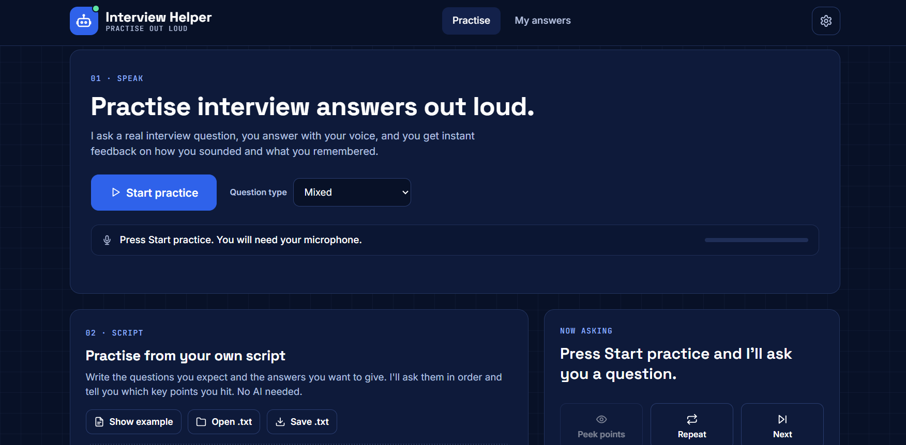

# Interview Helper: practise interview answers out loud



- **Try it online:** https://interview-helper-ten.vercel.app/#practise
- **Demo video:** (link coming)

Interview Helper is a voice interview coach. It reads an interview question out loud (from a question bank you can edit, or your own script), listens to your spoken answer, and immediately tells you how you came across: length, pace, filler words, long pauses, whether you said "I" or "we", and whether you ended with a result. With optional AI, it also judges your content (STAR structure) and asks a follow-up question, like a real interviewer would.

It also **remembers your best answers**. After an attempt, the AI can turn *your own story* into a polished model answer (it never invents achievements, and leaves `[placeholders]` for missing details), or you can write your own. You edit it, save it, and next time you practise that question Interview Helper checks which **key points** you hit.

## Pages

- **Practise** (home): start practice, load your script, see the current question, the live answer and timer, feedback tiles, key points hit, and your model answer.
- **My answers**: session summary and history, plus your saved model answers, which you can practise, edit, delete, add, import or export.
- **Settings** (cog icon, top right): choose an AI provider (Chrome built-in, Gemini, OpenAI or off), enter an API key, and see the voice commands.

## Requirements

- **Google Chrome** or **Microsoft Edge** on a desktop. Firefox and Safari don't support the speech recognition API.
- A microphone and speakers (headphones are best).
- An internet connection: Chrome's speech recognition runs on Google's servers.
- Either the Vercel link above, or Python 3 to run a small local web server.
- Node.js is optional, only for the tests.

Nothing to install: no npm packages and no build step.

## Run it locally

```bash
cd interview-helper
python3 -m http.server 8000
```

Open **http://localhost:8000** in Chrome (on Windows, don't use the `http://[::]:8000` link it prints), click **Start practice**, and allow microphone access. Then:

1. Interview Helper reads a question aloud.
2. Answer out loud. Say **"I'm done"**, or stay quiet for 5 seconds, when you finish.
3. Get your feedback on screen and read aloud, then say **"next question"** when you're ready.

## Optional: AI (free options available)

Delivery feedback works with no AI at all. AI adds content feedback (STAR), follow-up questions and model answers. Open **Settings** and pick a provider:

- **Chrome built-in AI**: free, no key, runs on your own computer, so your answers never leave it. Needs Chrome 148+ on a desktop with 16 GB RAM or a GPU with 4 GB+ VRAM, plus 22 GB free disk. It asks you to confirm a one-time download of a few GB first.
- **Google Gemini**: free tier, no credit card. Get a key at [aistudio.google.com](https://aistudio.google.com) → *Get API key* and paste it in. Uses `gemini-flash-lite-latest` by default.
- **OpenAI**: paid. Paste a key from platform.openai.com. Uses `gpt-4o-mini` by default.

Keys are stored only in your browser, never in the code.

## Script mode: practise your own answers like flashcards

Write the questions you expect and the answers you want to give, in a `.txt` file or straight into the **02 · Script** box:

```
Q: Tell me about yourself.
A: I'm a third-year software engineering student at Glasgow...
- third year software engineering        ← optional key points
- won the AI hackathon
```

Click **Load script**, then **Practise my script**. Interview Helper asks each question in order, listens, and shows what % of your key points you hit, with your script marked up to show what you said and what you missed. It matches keywords, so you don't have to say it word for word.

## What it measures

- **Length:** time from your first to last word. Good: 1 to 2½ minutes.
- **Pace:** words per minute. Good: 100 to 170.
- **Filler words:** "um", "uh", "like", "you know", "basically", "kind of"…, skipping real uses like "I *like* Java". Good: 2 or fewer per minute.
- **Long pauses:** silences of 3+ seconds, measured from the microphone volume. Good: 0 to 1.
- **"I" vs "we":** whether you made clear what *you* did. Good: more "I" than "we".
- **Result:** whether you ended with an outcome ("delivered", "improved"…) or a number.
- **Key points hit:** how many of your saved key points you mentioned (by keywords).
- **STAR, strengths and follow-up:** from the AI, if switched on.

All the thresholds live in one place (`LIMITS` in `js/analysis.js`), so they're easy to change.

## Voice commands

- **"Next question"** / **"Skip"**: asks a new question (or the next one in your script)
- **"Repeat"**: reads the question again
- **"I'm done"**: ends your answer
- **"How did I do?"**: repeats your feedback
- **"How did I do overall?"**: a spoken summary of the session
- **"Follow up"**: asks the AI's follow-up question about your answer
- **"Read my model answer"**: reads your saved answer aloud
- **"Try that again"**: asks the same question again
- **"Help"** / **"Stop listening"**

## Saved answers

Saved model answers and scripts are kept in your browser (localStorage), so they're still there after a refresh. Use **Export** / **Import** on the My answers page to back them up or move them to another computer.

## Tests

```bash
node tests/analysis.test.js
```

## Project structure

```
interview-helper/
├── index.html
├── style.css
├── screenshots/home.png
├── js/
│   ├── questions.js   question bank (easy to add or remove questions)
│   ├── analysis.js    scoring: fillers, pace, key points (tested)
│   ├── ai.js          AI providers: Chrome built-in, Gemini, OpenAI
│   ├── icons.js       line icons
│   └── app.js         mic, speech, practice flow and the screen
├── tests/analysis.test.js
├── README.md
├── ai.md
└── WRITEUP.md
```
